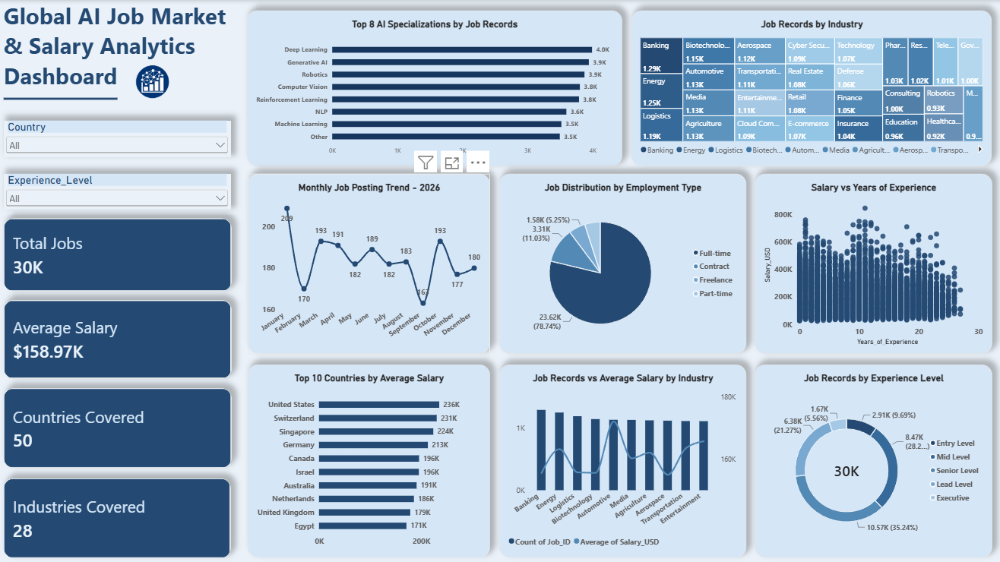

# Global AI Job Market & Salary Analytics

## Project Overview

This project analyzes the global AI job market using Microsoft Power BI. It explores job opportunities, salary trends, industry demand, AI specializations, and experience levels across different countries.

The goal is to understand patterns in the AI job market through interactive visualizations and data-driven insights.

## Problem Statement

The AI job market is expanding rapidly, but understanding job availability, salary differences, industry demand, and required experience across countries can be challenging.

This project uses Power BI to analyze job market data and identify meaningful patterns through interactive dashboards.

## Project Objectives

- Analyze AI job opportunities across different countries.
- Identify industries with higher AI job demand.
- Compare average salaries across countries and industries.
- Understand salary trends based on experience levels.
- Explore the distribution of different AI specializations.
- Present insights through interactive visualizations.

## Dataset

- **Dataset Name:** Global AI Jobs 2026
- **Source:** Kaggle
- **Total Records:** 30,000
- **Format:** Excel (.xlsx)

The dataset contains job-related information covering salaries, industries, countries, AI specializations, experience levels, and employment types.

**Dataset Source:** [Global AI Jobs 2026 – Kaggle](https://www.kaggle.com/datasets/datascikhan/global-ai-jobs-2026)

## Data Cleaning and Transformation

The dataset was reviewed and prepared before creating the dashboard.

The preparation process included:

- Checking the dataset structure and column names.
- Identifying missing and duplicate values.
- Reviewing data types and formatting.
- Preparing columns for analysis.
- Loading the cleaned dataset into Power BI.
- Using Power Query for data transformation.

## Key Performance Indicators (KPIs)

The dashboard includes four KPI cards to provide a quick overview of the AI job market:

1. **Total Jobs** – Displays the total number of job records.
2. **Average Salary** – Shows the average salary across job listings.
3. **Countries Covered** – Displays the number of countries represented.
4. **Industries Covered** – Shows the number of industries included in the dataset.

## Dashboard Visualizations

The dashboard contains eight visualizations:

1. **Job Type Distribution – Pie Chart:** Displays the distribution of jobs by employment type.
2. **Jobs Posted by Month – Line Chart:** Shows monthly trends in job postings.
3. **Industry Analysis – Combo Chart:** Compares job count and average salary across industries.
4. **Average Salary by Country – Bar Chart:** Compares average salaries across countries.
5. **Jobs by Industry – Treemap:** Visualizes job distribution across different industries.
6. **Salary vs. Years of Experience – Scatter Chart:** Explores the relationship between experience and salary.
7. **Jobs by AI Specialization – Bar Chart:** Compares demand across AI specializations.
8. **Experience Level Distribution – Donut Chart:** Shows job distribution across experience levels.

## Interactive Features

The dashboard includes interactive slicers to make data exploration easier:

- **Country Slicer:** Filters the dashboard based on selected countries.
- **Experience Level Slicer:** Filters job records based on experience levels.

These slicers allow users to explore different aspects of the AI job market dynamically.

## Tools and Technologies

- **Microsoft Power BI** – Dashboard development and data visualization.
- **Microsoft Excel** – Data storage and initial data preparation.
- **Power Query** – Data cleaning and transformation.
- **DAX (Data Analysis Expressions)** – Creating calculated measures and KPIs.
- **Kaggle** – Dataset source.

## Project Workflow

1. **Data Collection:** Obtained the Global AI Jobs 2026 dataset from Kaggle.
2. **Data Preparation:** Reviewed and prepared the dataset using Excel.
3. **Data Transformation:** Used Power Query to clean and transform the data.
4. **Data Analysis:** Created DAX measures for KPI calculations and analysis.
5. **Dashboard Development:** Built interactive charts, KPI cards, and slicers in Power BI.
6. **Insights:** Analyzed job trends, salary patterns, industries, and AI specializations.

## Key Areas of Analysis

The dashboard helps explore the following questions:

- Which AI specializations have more job opportunities?
- Which industries have higher AI job demand?
- How do salaries vary across different countries?
- What is the relationship between salary and work experience?
- Which experience levels have more job opportunities?
- How are jobs distributed across different employment types?

## How to View the Dashboard

1. Download the `.pbix` file from this repository.
2. Open the file using Microsoft Power BI Desktop.
3. If required, update the dataset source path.
4. Refresh the data to load the latest information.
5. Explore the dashboard using the interactive slicers and visualizations.

## Project Note

This project was developed as part of my Data Analytics learning journey to gain practical experience in data preparation, analysis, and dashboard development using Power BI.

---
